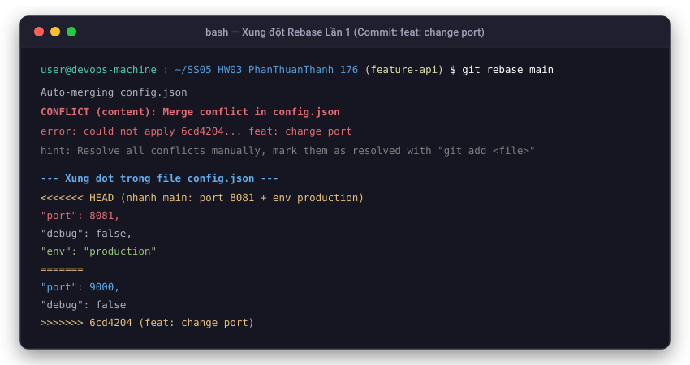
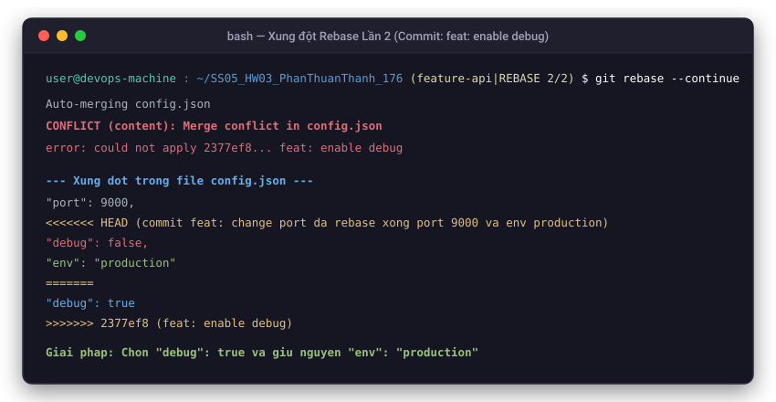
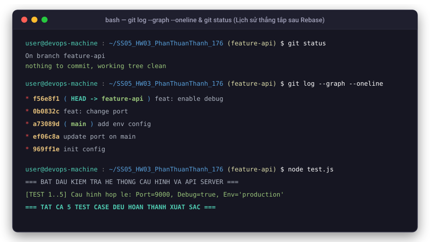

# BÁO CÁO BÀI TẬP 3: XỬ LÝ XUNG ĐỘT PHỨC TẠP TRONG QUÁ TRÌNH REBASE

**Học viên:** Phan Thuận Thành  
**Đường dẫn trên GitHub:** `homework/session_05/ex3/`  
**Môn học:** DevOps Fundamentals - Session 05  

---

## 1. Mục tiêu
- Hiểu rõ sự khác biệt bản chất giữa giải quyết xung đột khi **Merge** và khi **Rebase**.
- Nắm vững và thực hành quy trình giải quyết xung đột từng bước (**step-by-step conflict resolution**) trong Rebase.
- Đưa toàn bộ lịch sử commit của nhánh tính năng (`feature-api`) lên trên đầu nhánh chính (`main`) một cách thẳng hàng, sạch sẽ, không tạo merge commit rác.
- Bảo toàn tuyệt đối mã nguồn của nhánh chính (`"env": "production"`) đồng thời tích hợp chính xác các tính năng của nhánh phụ (`"port": 9000`, `"debug": true`).

---

## 2. Bối cảnh & Thiết lập ban đầu

### Bước 1: Khởi tạo tệp tin `config.json` ban đầu trên nhánh `main`
Nội dung ban đầu của `config.json`:
```json
{
  "port": 8080,
  "debug": false
}
```
Lệnh thực hiện:
```bash
git add .
git commit -m "init config"
```

### Bước 2: Nhánh `feature-api` phát triển tính năng mới
Tạo nhánh `feature-api` từ `main`:
```bash
git checkout -b feature-api
```
- **Commit 1 (`feat: change port`):** Sửa `"port": 8080` thành `"port": 9000`.
  ```bash
  git add config.json && git commit -m "feat: change port"
  ```
- **Commit 2 (`feat: enable debug`):** Sửa `"debug": false` thành `"debug": true`.
  ```bash
  git add config.json && git commit -m "feat: enable debug"
  ```

### Bước 3: Nhánh `main` cập nhật độc lập từ các thành viên khác
Quay trở lại nhánh `main`:
```bash
git checkout main
```
- **Commit 1 (`update port on main`):** Sửa `"port": 8080` thành `"port": 8081`.
  ```bash
  git add config.json && git commit -m "update port on main"
  ```
- **Commit 2 (`add env config`):** Thêm cấu hình môi trường `"env": "production"`.
  ```bash
  git add config.json && git commit -m "add env config"
  ```

### Sơ đồ phân nhánh trước khi Rebase (`git log --graph --oneline --all`):
```text
* a73089d (HEAD -> main) add env config
* ef06c8a update port on main
| * 2377ef8 (feature-api) feat: enable debug
| * 6cd4204 feat: change port
|/  
* 969ff1e init config
```

---

## 3. Quá trình Rebase và Giải quyết xung đột từng chặng

Quay trở lại nhánh `feature-api` và thực hiện rebase lên `main`:
```bash
git checkout feature-api
git rebase main
```

---

### Chặng 1: Xung đột tại commit `feat: change port` (Rebasing 1/2)

#### 1. Nguyên nhân phát sinh xung đột:
Git đưa con trỏ về commit mới nhất của `main` (`add env config`), sau đó áp dụng commit đầu tiên của `feature-api` là `feat: change port`. Cả hai nhánh đều đã chỉnh sửa trường `"port"` (`8081` trên `main` và `9000` trên `feature-api`).

#### 2. Dấu hiệu xung đột trong tệp `config.json`:
```json
{
<<<<<<< HEAD
  "port": 8081,
  "debug": false,
  "env": "production"
=======
  "port": 9000,
  "debug": false
>>>>>>> 6cd4204 (feat: change port)
}
```



#### 3. Cách giải quyết thủ công:
- Giữ giá trị `"port": 9000` của nhánh tính năng.
- Giữ nguyên cấu hình `"env": "production"` mới cập nhật từ nhánh `main`.
- Nội dung file `config.json` sau khi giải quyết:
```json
{
  "port": 9000,
  "debug": false,
  "env": "production"
}
```

#### 4. Lệnh đánh dấu giải quyết và tiếp tục rebase:
```bash
git add config.json
git rebase --continue
```

---

### Chặng 2: Xung đột tại commit `feat: enable debug` (Rebasing 2/2)

#### 1. Nguyên nhân phát sinh xung đột:
Git áp dụng commit thứ hai `feat: enable debug`. Ở commit gốc, dòng `"debug": true` nằm ở cuối đối tượng JSON (không có dấu phẩy `,`). Tuy nhiên, ở trạng thái hiện tại (sau chặng 1), phía sau thuộc tính `"debug"` đã có thêm trường `"env": "production"` và dấu phẩy ngăn cách. Git nhận thấy sự thay đổi ngữ cảnh dòng và tạm dừng để lập trình viên xác nhận.

#### 2. Dấu hiệu xung đột trong tệp `config.json`:
```json
{
  "port": 9000,
<<<<<<< HEAD
  "debug": false,
  "env": "production"
=======
  "debug": true
>>>>>>> 2377ef8 (feat: enable debug)
}
```



#### 3. Cách giải quyết thủ công:
- Bật cờ debug `"debug": true` theo mục tiêu của commit `feat: enable debug`.
- Giữ nguyên thuộc tính `"env": "production"` từ `main`.
- Nội dung tệp `config.json` hoàn chỉnh:
```json
{
  "port": 9000,
  "debug": true,
  "env": "production"
}
```

#### 4. Lệnh hoàn tất Rebase:
```bash
git add config.json
git rebase --continue
```
Terminal thông báo thành công:
```text
Successfully rebased and updated refs/heads/feature-api.
```

---

## 4. So sánh Giải quyết xung đột: Merge vs Rebase

| Tiêu chí | Giải quyết xung đột khi Merge | Giải quyết xung đột khi Rebase |
| :--- | :--- | :--- |
| **Bản chất** | Kết hợp 2 nhánh lại với nhau qua một commit gộp (Merge Commit). | Viết lại lịch sử, đặt các commit của nhánh feature nối tiếp lên ngọn nhánh base. |
| **Tần suất xử lý xung đột** | Xảy ra **duy nhất 1 lần** cho toàn bộ khác biệt giữa 2 nhánh. | Xảy ra **từng chặng** (step-by-step) ứng với từng commit bị xung đột. |
| **Cấu trúc lịch sử Git** | Lịch sử phân nhánh đan xen, có các đường nối chéo và commit merge phụ. | Lịch sử thẳng tắp (linear history), sạch sẽ, dễ tra cứu `git bisect` và `git log`. |
| **Tính an toàn & Hoàn tác** | Dễ quan sát trạng thái ban đầu, hoàn tác đơn giản bằng `git merge --abort`. | Phải cẩn trọng vì viết lại lịch sử commit SHA. Hoàn tác qua `git rebase --abort`. |
| **Môi trường khuyến nghị** | Áp dụng khi đưa nhánh tính năng vào nhánh release chung, bảo lưu lịch sử. | Áp dụng trên nhánh cá nhân cục bộ trước khi tạo Pull Request để giữ lịch sử đẹp. |

---

## 5. Kiểm tra kết quả

### 5.1. Trạng thái Git sau Rebase
```bash
git status
```
**Kết quả:**
```text
On branch feature-api
nothing to commit, working tree clean
```

### 5.2. Lịch sử Git thẳng hàng (`git log --graph --oneline`)
```bash
git log --graph --oneline
```
**Kết quả:**
```text
* f56e8f1 (HEAD -> feature-api) feat: enable debug
* 0b0832c feat: change port
* a73089d (main) add env config
* ef06c8a update port on main
* 969ff1e init config
```



> **Nhận xét:** Lịch sử hoàn toàn thẳng hàng, không có commit merge rác. Các commit của `feature-api` (`0b0832c`, `f56e8f1`) nằm nối tiếp ngay trên commit mới nhất của `main` (`a73089d`).

### 5.3. Nội dung tệp `config.json` sau cùng
```json
{
  "port": 9000,
  "debug": true,
  "env": "production"
}
```

---

## 6. Hướng dẫn chạy và kiểm thử chương trình

Chương trình được tích hợp sẵn API Server (`server.js`) và bộ kịch bản kiểm thử tự động (`test.js`), tuân thủ nghiêm ngặt quy định không chứa comment trong mã nguồn:

### 1. Lệnh thực thi kiểm thử:
```bash
node test.js
```

### 2. Kết quả kiểm thử thực tế từ Terminal:
```text
=== BAT DAU KIEM TRA HE THONG CAU HINH VA API SERVER ===

[TEST 1] Kiem tra doc tep tin config.json:
Noi dung file config.json: {"port":9000,"debug":true,"env":"production"}
Cau hinh co ban hop le: true

[TEST 2] Kiem tra cac gia tri sau Rebase conflict resolution:
Port thuoc feature-api (9000): true
Debug thuoc feature-api (true): true
Env bao toan tu nhanh main ('production'): true

[TEST 3] Khoi tao API Server voi cau hinh sau Rebase:
Server khoi chay thanh cong tren port 9000

[TEST 4] Kiem tra endpoint /health:
Phan hoi tu /health: {"status":"OK","port":9000,"debug":true,"env":"production"}
Trang thai status === 'OK': true
Gia tri port khop: true
Gia tri debug khop: true
Gia tri env khop: true

[TEST 5] Kiem tra endpoint /config:
Phan hoi tu /config: {"port":9000,"debug":true,"env":"production"}
Cau hinh khop 100% voi config.json: true

Dong server thanh cong

=== TAT CA 5 TEST CASE DEU HOAN THANH XUAT SAC ===
```
